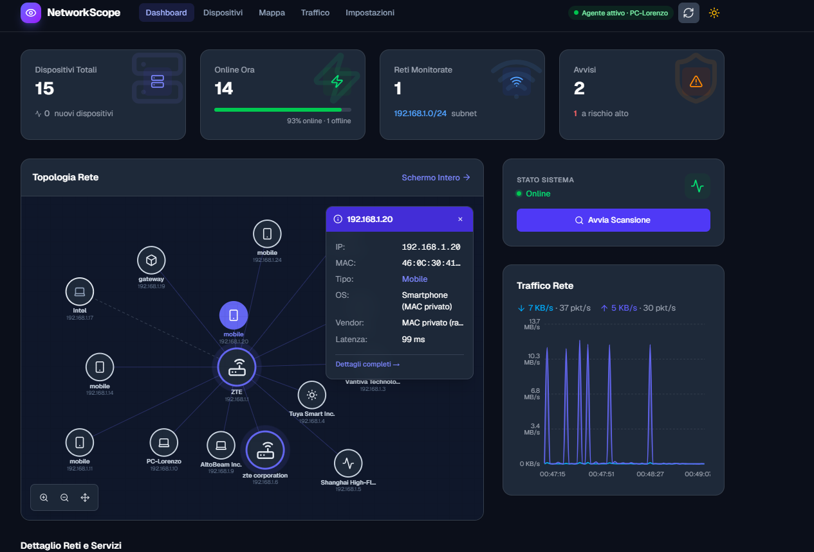
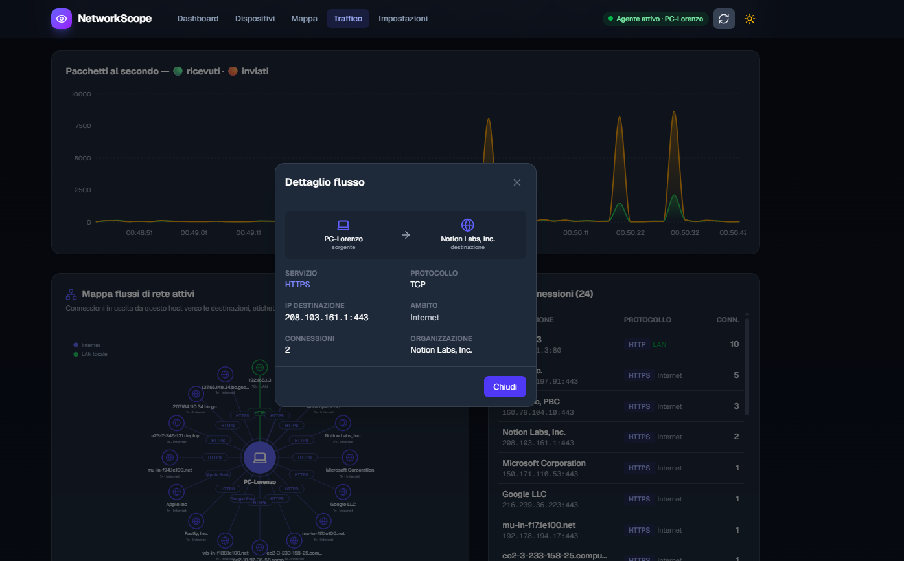
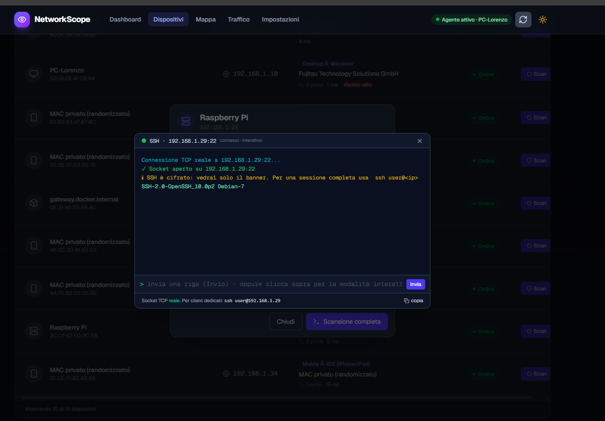

<div align="center">

# 👁️ NetworkScope (`Net_Eye`)

### _La tua rete locale, finalmente sotto controllo._

**Dashboard di monitoraggio rete in tempo reale — scoperta dispositivi, scansione porte, analisi flussi e topologia interattiva in stile Packet Tracer.**

<br/>


</div>

---

## ⚡ Avvio Rapido (Quick Start)

Avvia l'intero stack (frontend + backend di scansione reale) in **meno di un minuto**:

### Opzione A: Con Docker (Consigliata)
```bash
# Avvia frontend (porta 3000) e backend di scansione (porta 8000)
docker compose up --build

# Con autenticazione token abilitata:
NS_TOKEN=un-segreto-forte docker compose up --build
```
> 💡 *Nota*: su Linux Docker usa `network_mode: host` per scansionare direttamente la LAN reale.

### Opzione B: In locale con Node.js (≥ 20)
```bash
# 1. Installa le dipendenze
npm install

# 2. Avvia il backend di scansione REALE (Terminale 1)
npm run backend

# 3. Avvia la dashboard Next.js (Terminale 2)
npm run dev
```
➡️ Apri **http://localhost:3000**: entro 15 secondi vedrai comparire la mappa viva della tua rete locale!

### Opzione C: Modalità Demo Offline (Mock)
Se vuoi esplorare l'interfaccia senza effettuare scansioni sulla rete fisica:
```bash
npm run mock    # Terminale 1 (porta 8000 con dati finti)
npm run dev     # Terminale 2
```

<details>
<summary>📋 <b>Comandi npm disponibili</b></summary>

| Comando | Descrizione |
|---|---|
| `npm run backend` | 🛰️ Backend di scansione **reale** della LAN (porta 8000, zero dipendenze) |
| `npm run agent -- --agent http://SERVER:8000` | 🛰️ Modalità **agente** che riporta i dati a un server centrale |
| `npm run mock` | 🧪 Backend simulato con dati demo |
| `npm run oui` | 🏷️ Scarica il database IEEE OUI completo (~40k vendor) per la risoluzione offline |
| `npm run autostart:install` | 🔁 Configura l'avvio automatico al boot/login (a livello utente, no admin) |
| `npm run autostart:uninstall` | ↩️ Rimuove l'avvio automatico |
| `npm run dev` | Server di sviluppo frontend con hot-reload (porta 3000) |
| `npm run build` | Compilazione Next.js per produzione |
| `npm run lint` | Linter ESLint |
| `npm test` | Suite di test Vitest sui moduli server e pure function |

</details>

---

## 🖼️ Le Schermate

<table>
  <tr>
    <td width="50%"></td>
    <td width="50%"></td>
  </tr>
  <tr>
    <td align="center"><b>🏠 Dashboard</b><br/>KPI, topologia interattiva con nodi drag & drop e traffico live</td>
    <td align="center"><b>📈 Traffico</b><br/>Mappa mondiale dei flussi, processi sorgente, ASN, GeoIP e VirusTotal</td>
  </tr>
  <tr>
    <td width="50%"></td>
    <td width="50%" valign="top">
      <br/>
      <b>📇 Dispositivi + 🖥️ Terminale interattivo reale</b><br/>
      Inventario completo con risk scoring di sicurezza. Per ogni porta aperta puoi aprire direttamente il browser o un
      <b>terminale interattivo TCP reale</b> (es. sessione SSH con banner reale, Telnet, Redis, HTTP) integrato via proxy WebSocket.
      Completano l'app la <b>🗺️ Mappa topologica full-screen</b> e le <b>⚙️ Impostazioni</b> di gestione agenti e token.
    </td>
  </tr>
</table>

| Rotta | Sezione | Descrizione |
|---|---|---|
| `/` | 🏠 **Dashboard** | Hub centrale: KPI, topologia SVG compatta, traffico in tempo reale, azioni rapide |
| `/dispositivi` | 📇 **Dispositivi** | Inventario ricercabile per IP/vendor, dettagli di sicurezza, terminale su porte aperte, export CSV/PDF |
| `/mappa` | 🗺️ **Mappa** | Topologia di rete a schermo intero con zoom, pan, trascinamento nodi e ispezione |
| `/traffico` | 📈 **Traffico** | Throughput (KB/s), pacchetti/s, mappa mondiale dei flussi, associazione PID/processo, ASN e VirusTotal |
| `/impostazioni` | ⚙️ **Impostazioni** | Gestione multi-agente, download installer script, configurazione token, offline mode e chiave VirusTotal |

---

## ✨ Perché NetworkScope

> _"Conosci ogni dispositivo che respira sulla tua rete — prima che lo faccia qualcun altro."_

La maggior parte degli utenti non sa davvero cosa sia collegato al proprio router: telecamere IoT economiche, vecchi apparati dimenticati con SMB spalancato o smartphone con MAC casuali. 

**NetworkScope** trasforma l'output ostico dei vecchi tool da terminale in un pannello di controllo moderno, reattivo e gradevole:

| Senza NetworkScope 😵 | Con NetworkScope 😎 |
|---|---|
| `arp -a` in un terminale nero e statico | Topologia interattiva SVG drag & drop in stile Packet Tracer |
| "C'è qualcosa sull'IP `.47`, ma chissà cos'è" | Hostname, vendor, OS da TTL, porte aperte e tipologia in un click |
| Zero avvisi di sicurezza | Rilevamento automatico anomalie, trojan ports e risk score |
| Tool di monitoraggio pesanti anni '90 | UI moderna in Next.js 16 + Tailwind 4, tema Dark/Light nativo |

---

## 🎯 A chi serve (Target)

| 👤 Profilo | 💡 Caso d'uso |
|---|---|
| 🏠 **Home Lab & Smart Home** | Ispezione continua di IoT (Shelly, ESP), NAS, inverter FV, colonnine EV e dispositivi ospiti |
| 🛡️ **Cybersecurity & Studenti CTF** | Mappatura rapida del perimetro LAN, porte esposte, banner grabbing e connessioni esterne |
| 🧑‍💻 **Sysadmin & Retisti PMI** | Inventario immediato senza installare agenti pesanti o server Enterprise proprietari |
| 🎓 **Didattica Networking** | Visualizzazione dinamica e intuitiva del modello di rete per spiegare subnet e routing |

---

## 🚀 Funzionalità Principali

- 📊 **Dashboard Live**: Conteggio dispositivi totali, online/offline, reti monitorate e alert di sicurezza con refresh dinamico.
- 🗺️ **Topologia Interattiva SVG nativa**: Nodi trascinabili, zoom, pan, gateway evidenziato e pannello laterale (zero dipendenze pesanti tipo d3/vis.js).
- 🔍 **Scansione Reale & Zero Admin**: Ping-sweep parallelo sulla `/24`, lettura ARP, reverse DNS e port scan TCP senza privilegi amministrativi.
- 🧠 **Fingerprinting Intelligente**: Riconosce OS via TTL, vendor via IEEE OUI (40k record offline), MAC randomizzati (privacy iPhone/Android), inverter fotovoltaici, colonnine EV, stampanti, container Docker, camere RTSP e smart TV.
- 📈 **Monitoraggio Traffico & Pacchetti**: Throughput reale (KB/s, MB/s) e pacchetti/s campionati dai contatori di sistema ogni 2s con grafici fluidi.
- 🔗 **Analisi Flussi & Mappa Mondiale**: Correlazione tra connessione attiva, protocollo, processo locale (`tasklist`), geolocalizzazione, ASN dell'ISP e verifica IP malevoli via **VirusTotal**.
- 🔬 **Deep Packet Inspection (6000+ protocolli)**: Database integrato dal registro IANA con firme su trojan/worm noti. Con modulo opzionale `pcap` (Npcap/libpcap) campiona i payload reali.
- 🖥️ **Terminale Interattivo Web-to-TCP**: Click sulle porte aperte per interagire via browser con i servizi (sessioni SSH con banner autentico, Telnet, Redis, HTTP).
- 🛰️ **Architettura Multi-Agent**: Un unico server centrale può aggregare scansioni da più macchine/subnet diverse tramite script installer automatici (`.bat`, `.sh`, Python autonomo).
- 🔔 **Notifiche Realtime via WebSocket**: Aggiornamenti push istantanei all'ingresso di nuovi dispositivi sulla rete.
- 📤 **Export Dati**: Esportazione istantanea dell'inventario in formato CSV e PDF.

---

## 🏗️ Architettura del Sistema

```
🌐 Browser Client
   │  (WebSocket /api/v1/events + Polling)
   ▼
⚛️ Next.js 16 (App Router) ──► Proxy Same-Origin (/api/backend/[...path])
   │                           (Iniesta NS_TOKEN server-side, mai esposto al client)
   ├─ 🏠 /
   ├─ 📇 /dispositivi
   ├─ 🗺️ /mappa
   ├─ 📈 /traffico
   └─ ⚙️ /impostazioni
        │
        ▼
🔗 lib/api.ts (Unico punto di integrazione frontend)
        │
        ▼
🟩 Backend Server (server.mjs · Porta 8000 · Zero dipendenze esterne)
   ├─ 🛰️ Engine di scansione (ICMP sweep, ARP table, reverse DNS, TCP connect)
   ├─ 🧠 Moduli interni (lib/server/):
   │    ├─ netparse.mjs  ── TTL, MAC OUI, parser ARP
   │    ├─ dpi.mjs       ── 6150+ porte IANA, firme minacce
   │    ├─ geo.mjs       ── MaxMind GeoLite2 locale / ip-api fallback
   │    ├─ auth.mjs      ── Validazione token & ticket WS monouso
   │    └─ pcap.mjs      ── Cattura pacchetti (Npcap / libpcap opzionale)
   └─ 🔌 Proxy WebSocket/TCP (/api/v1/connect) ── RFC6455 verso IP LAN
        │
        ▼
🌐 Subnet Locale (LAN /24) + Agenti Remoti
```

---

## 🔬 Tecniche di Monitoraggio Reali

Tutte le tecniche sono attive e funzionanti in `server.mjs` sfruttando utility di sistema standard:

### 🔎 Scoperta dei dispositivi
| Tecnica | Strumento | Cosa rileva |
|---|---|---|
| **ICMP ping-sweep** | `ping` batch paralleli su `1–254` | Host attivi e responsivi nella `/24` |
| **Lettura ARP** | `arp -a` di sistema | Indirizzi MAC e risoluzione locale |
| **Re-scan periodico** | Loop automatico (45s ARP / sweep periodico) | Nuovi arrivi e rilevamento disconnessioni |

### 🧠 Identificazione e fingerprinting
| Tecnica | Meccanismo | Risultato |
|---|---|---|
| **OS via TTL** | Ispezione del TTL della risposta ICMP (64=Linux/Mac, 128=Windows, 255=Embedded) | Famiglia del sistema operativo |
| **Latenza RTT** | Tempo di round-trip del pacchetto ping | Stato e qualità del collegamento |
| **TCP Connect Scan** | Apertura socket TCP su porte note (~24 standard + scan profondo) | Servizi in ascolto |
| **Banner Grabbing** | Lettura stringhe di benvenuto SSH/FTP, header HTTP `Server:`, certificati TLS | Versione esatta del software |
| **SSDP / UPnP** | Multicast M-SEARCH su `239.255.255.250:1900` + parsing XML | Nome, modello e marca (Smart TV, NAS, stampanti) |
| **Risoluzione Nomi** | Reverse DNS (PTR) + NetBIOS (`nbtstat`) | Hostname leggibile |
| **Vendor OUI** | Prefisso MAC confrontato con database IEEE offline (~40k vendor) | Costruttore della scheda di rete |
| **MAC Randomizzato** | Bit *locally-administered* nel MAC address | Individuazione privacy mode (iOS / Android) |
| **Risk Scoring** | Euristica pesata (porte sensibili come 23, 445, 3389, 5900 + vendor sconosciuto) | Indice di rischio 0–100 (Basso/Medio/Alto) |

### 📈 Flussi, Traffico e Sicurezza
| Tecnica | Strumento | Cosa misura / evidenzia |
|---|---|---|
| **Contatori Scheda** | `netstat -e` (Windows) / `/proc/net/dev` (Linux) | Throughput (KB/s, MB/s) e pacchetti/s in tempo reale |
| **Connessioni Attive** | `netstat -ano` (stati ESTABLISHED) | Socket aperte da/verso la macchina |
| **Processo Locale** | Mappatura PID su `tasklist` | Applicazione sorgente del traffico (es. `brave.exe`, `claude.exe`) |
| **Arricchimento Destinazione** | MaxMind GeoLite2 locale (`.mmdb`) o fallback `ip-api` | Paese, città, coordinate geografiche e ASN/Organizzazione |
| **Threat Intelligence** | Porte trojan note (SubSeven, NetBus, Mirai...) + **VirusTotal API** | Evidenziazione visiva degli IP malevoli e notifiche |
| **Terminale su Porta** | Proxy RFC6455 WebSocket ↔ TCP socket verso IP RFC1918 | Shell interattiva dal browser sul servizio di rete |

> ⚠️ **Nota di trasparenza tecnica sui limiti:** L'analisi approfondita dei flussi e dei processi riguarda la macchina su cui gira lo scanner/agente (socket table locale). Per monitorare i flussi di pacchetti generati da *altri* apparati della LAN è necessaria una porta mirror sullo switch o l'adozione di packet capture (Npcap/libpcap) con privilegi di rete adeguati.

---

## 🧩 Capacità Avanzate & Moduli Opzionali

Ogni modulo aggiuntivo opera in modalità **best-effort con graceful degradation**: se un componente o privilegio non è presente, l'applicazione continua a funzionare regolarmente mostrando lo stato effettivo nel pannello delle evidenze.

### 📡 Cattura Pacchetti Reale (Npcap / libpcap)
Consente di quantificare i byte reali per singolo flusso e campionare i payload per la Deep Packet Inspection:
- **Windows**: installa [Npcap](https://npcap.com/) abilitando l'opzione *"WinPcap API-compatible Mode"*. Esegui il backend da una console elevata (`Amministratore`).
- **Linux**: installa `libpcap-dev` e assegna le capability raw: `sudo setcap cap_net_raw,cap_net_admin=eip $(which node)`.
- **Docker**: l'immagine `Dockerfile.backend` include già `libpcap` con capability `NET_RAW` e `NET_ADMIN`.

### 🗺️ Geolocalizzazione Offline MaxMind
Per non trasmettere query IP verso API terze:
1. Scarica i file `GeoLite2-City.mmdb` e `GeoLite2-ASN.mmdb` dal sito ufficiale MaxMind.
2. Inseriscili nella cartella `data/` del progetto.
3. Al riavvio, il provider commuterà automaticamente su MaxMind offline.

---

## 🔐 Sicurezza & Produzione

NetworkScope è progettato per il monitoraggio della **propria infrastruttura locale**.

### Misure di protezione già integrate
- **Token Server-Side protetto**: Impostando `NS_TOKEN`, il frontend Next.js funge da reverse proxy same-origin (`/api/backend/*`). Il segreto risiede esclusivamente nel processo server e non viene mai incluso nel bundle JavaScript client né esposto in DevTools.
- **Ticket WebSocket Monouso**: Le sessioni del terminale non passano token statici nei parametri URL: richiedono preventivamente un ticket usa-e-getta temporaneo (`POST /api/v1/ws-ticket`, scadenza 30s).
- **Protezione RFC1918**: Il proxy del terminale accetta connessioni socket **esclusivamente verso indirizzi IP privati** di rete locale, prevenendo rimbalzi arbitrari verso Internet.
- **Modalità 100% Offline**: Avviando il backend con `NS_OFFLINE=1`, vengono disabilitate tutte le chiamate esterne (geolocalizzazione remota e VirusTotal).
- **Resilienza ai crash**: Gestione globale con timeout su tutte le chiamate di rete, banner grabbing e comandi di sistema.

---

## 🔌 API Reference

Il frontend interagisce con il backend tramite un unico data layer (`lib/api.ts`) conforme a questo schema:

| Metodo | Endpoint | Scopo |
|---|---|---|
| `GET` | `/api/v1/devices` | Restituisce la lista di tutti i dispositivi identificati |
| `GET` | `/api/v1/devices/:ip` | Dettaglio approfondito del singolo dispositivo |
| `PATCH` | `/api/v1/devices/:ip` | Modifica metadati (es. assegnazione hostname personalizzato) |
| `POST` | `/api/v1/scan/network` | Attiva una scansione on-demand della subnet |
| `POST` | `/api/v1/scan/ports/:ip` | Avvia scansione porte approfondita sul target |
| `GET` | `/api/v1/agents` | Elenco degli agenti attivi e stato dell'heartbeat |
| `GET` | `/api/v1/traffic` | Metriche temporali di throughput e pacchetti/s |
| `GET` | `/api/v1/connections` | Tabella flussi e connessioni con arricchimento Geo/ASN |
| `GET` | `/api/v1/capabilities` | Stato dei motori (PCAP, DPI, GeoProvider) |
| `WS` | `/api/v1/events` | Stream WebSocket eventi e notifiche nuovi host |
| `WS` | `/api/v1/connect` | Proxy terminale interattivo TCP (con ticket monouso) |

---

## 📜 Licenza

Distribuito con licenza **MIT**. Consulta il file `LICENSE` per ulteriori dettagli.

<div align="center">
<br/>
<sub>Sviluppato con ⚛️ Next.js, ❤️ e una sana curiosità verso i pacchetti che transitano sulla rete.</sub>
</div>
## 📚 Teoria di ARP Redirection (MITM)

L'ARP (Address Resolution Protocol) è il meccanismo con cui un host traduce un indirizzo IP in un MAC address sulla LAN. Uno **spoofing ARP** consiste nell'inviare risposte ARP fasulle, facendo credere alla vittima che l'indirizzo MAC del router sia quello dell'attaccante (e viceversa al router). Così il traffico della vittima transita fisicamente attraverso l'attaccante, che può:

1. **Forwardarlo** verso la destinazione reale, in modo da non interrompere la connettività.
2. **Analizzarlo** (DPI, logging, ecc.) mentre transita.

Il processo tipico ("bridge" trasparente, il più semplice e il meno invasivo) è:
- Abilitare l'IP forwarding sul host attaccante.
- Lanciare `arpspoof` in due direzioni:
  - Vittima → router (finto ARP del router)
  - Router → vittima (finto ARP della vittima)
- Attendere (script idle) fino a interruzione, poi pulire.

> **Niente NAT/`iptables` per il forwarding stesso**: con l'ARP spoofing bidirezionale e l'IP forwarding abilitato, il kernel inoltra già il traffico della vittima con il suo indirizzo IP originale — l'host non ha il proprio ARP avvelenato per l'IP della vittima, quindi risolve il suo MAC reale normalmente. Aggiungere regole NAT qui è superfluo e, se fatto in modo troppo ampio (es. una DNAT che intercetta *tutte* le connessioni verso l'host, non solo quelle della vittima), rischia di bloccare anche gli altri servizi che girano sullo stesso host — è quello che succedeva in una versione precedente di questo script, corretto il 2026-10-16.

Questo metodo non richiede alcuna modifica al router e può essere attivato/disattivato rapidamente, rendendolo ideale per **test di sicurezza** o per **monitorare un singolo dispositivo** nella rete domestica.

> **Nota**: è necessario operare con privilegi `root` su Linux/WSL. Su Windows nativo servirebbe un tool equivalente (es. `winpcap` + `arp -s`), ma per ora il nostro script è pensato per ambienti Linux.

## ⚙️ Metodo 2 – ARP Redirection (MITM)

**Scopo**: catturare il traffico di un dispositivo specifico della LAN reindirizzandolo verso il backend di NetworkScope tramite spoofing ARP. Questo metodo non richiede modifiche al router e può essere avviato e fermato a piacere.

### Prerequisiti
- Sistema Linux (o WSL) con privilegi `sudo`.
- Pacchetto `arpspoof` (parte di `dsniff`). Installabile con `sudo apt install dsniff` su Debian/Ubuntu.
- IP forwarding abilitato (lo script lo abilita automaticamente).
- Il backend di NetworkScope in ascolto sulla porta 8000 (o altra porta specificata).

### Uso
```bash
sudo ./scripts/arp_redirect.sh <IP_VITTIMA> <IP_ROUTER> [PORTA_BACKEND]
```
- `<IP_VITTIMA>`: l'indirizzo IP del dispositivo di cui vuoi monitorare il traffico.
- `<IP_ROUTER>`: l'indirizzo IP del gateway della tua LAN.
- `[PORTA_BACKEND]` (opzionale): porta su cui è in ascolto il backend (default 8000).

Lo script:
1. Abilita l'IP forwarding (sull'host, se nel container non è scrivibile — vedi deploy Raspberry Pi).
2. Avvia `arpspoof` in entrambe le direzioni (vittima → router e router → vittima).
3. Mantiene il MITM attivo finché non premi `Ctrl+C` (o non lo fermi dalla GUI), a quel punto termina `arpspoof` e ripristina lo stato iniziale. **Nessuna regola `iptables` viene toccata**: il traffico degli altri servizi sull'host (SSH incluso) non è mai interessato, nemmeno mentre il MITM è attivo.

### Sicurezza
- **Solo per reti di prova o reti di tua proprietà.** L'uso non autorizzato è illegale.
- Lo script non modifica la configurazione del router; tutti i cambiamenti sono temporanei e revocabili al termine.
- Per fermare l'intercettazione, premi `Ctrl+C` (o il pulsante "Ferma" dalla GUI); lo script termina `arpspoof` e disabilita l'IP forwarding — nessuna regola di rete persistente viene mai creata.

### Integrazione con NetworkScope
Una volta avviato lo script, il backend di NetworkScope riceverà il traffico del dispositivo vittima attraverso la normale interfaccia di rete e potrà analizzarlo come se fosse il traffico della macchina locale. Puoi quindi utilizzare le funzionalità di monitoraggio del flusso, DPI e visualizzazione già presenti nell'app.

---

## 🍓 Deploy su Raspberry Pi

NetworkScope è pensato per girare 24/7 su un Raspberry Pi come sonda di rete permanente (Docker + `network_mode: host`, nativo su Linux).

### Prerequisiti
- Raspberry Pi 3/4/5 con **Raspberry Pi OS (64-bit consigliato)**.
- Accesso SSH o terminale locale.
- Il Pi collegato alla stessa LAN che vuoi monitorare (via cavo per stabilità, consigliato).

### Deploy automatico
```bash
git clone <url-del-repo> networkscope   # o copia la cartella sul Pi (scp/rsync)
cd networkscope
chmod +x scripts/deploy-raspberrypi.sh
./scripts/deploy-raspberrypi.sh
```

Lo script [`scripts/deploy-raspberrypi.sh`](scripts/deploy-raspberrypi.sh):
1. Installa Docker + plugin Compose se mancanti.
2. Abilita il servizio Docker al boot (`systemctl enable docker`).
3. Builda e avvia i container con `docker compose up --build -d`.

Il Dockerfile del backend include già `dsniff` (per `arpspoof`), necessario per il **Metodo 2 – ARP Redirection** descritto sopra, oltre a `libpcap` per la cattura pacchetti reale.

### Autostart dopo reboot
`restart: unless-stopped` nel `docker-compose.yml` + `docker` abilitato come servizio systemd bastano: il Pi riparte, Docker riparte, i container ripartono — nessuna configurazione aggiuntiva.

### Aggiornare dopo un cambiamento
```bash
git pull
docker compose up --build -d
```

### Note specifiche Pi
- La build nativa del modulo `cap` (binding libpcap) richiede compilazione: la prima build può richiedere qualche minuto in più rispetto a un PC (già gestito dallo script/Dockerfile, non serve azione manuale).
- Per il Metodo 2 (ARP Redirection) via Docker sul Pi, entra nel container ed esegui lo script lì dentro (ha già i binari e le capability `NET_ADMIN`/`NET_RAW`):
  ```bash
  docker compose exec backend sh -c "./scripts/arp_redirect.sh <victim_ip> <router_ip>"
  ```
- Monitora temperatura/throughput su Pi 3 se analizzi reti molto cariche; su Pi 4/5 non è un problema in condizioni normali.

---
